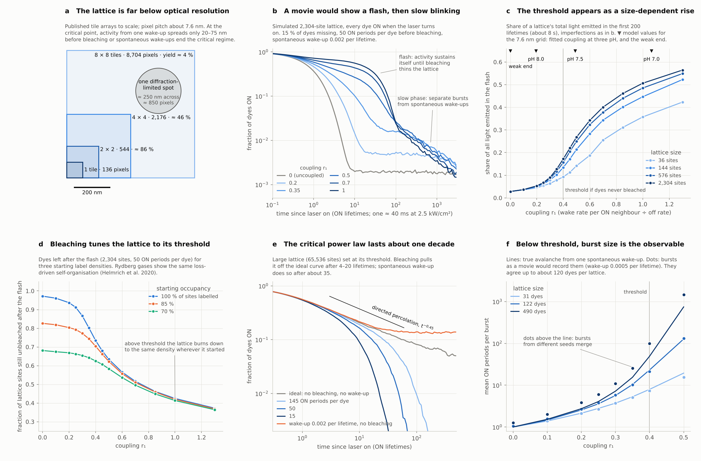

# Dye lattice: a molecular directed-percolation transition on DNA origami

Code, simulation results and theory behind the Nano-Innovator Grant 2026 proposal
*"Dyes that wake their neighbours: a molecular directed-percolation transition on DNA origami"*
(Calvin Sabastian Tanzil, Institut Teknologi Bandung).

The proposal asks two questions:

1. **Can a lit Cy5 dye switch on a dark neighbour?** On DNA origami, Cy5 dyes closer than 10 nm change
   each other's blinking ([Helmerich et al. 2022](https://doi.org/10.1038/s41592-022-01548-6)). A published
   model ([Ebert, Sauer and Doose 2026](https://doi.org/10.1371/journal.pcbi.1014322)) explains it as energy
   transfer from a lit dye to a dark one. Aim 1 measures the hand-over chance *B* on pairs 3 to 9.5 nm apart.
2. **Does a lattice of such dyes show an activity threshold?** A 2D lattice of coupled dyes is a contact
   process, the standard model of directed percolation. Aim 2 looks for the threshold between activity that
   dies out and activity that sustains itself.

## What is here

| Folder | Contents |
| --- | --- |
| `coupling/` | `coupling_from_fluopy.py` recomputes the pair coupling from the published model's Cy5 spectra and rate constants: R0 = 4.29 nm, d0 = 6.76 nm, B(d) = 1/(1 + (d/d0)^6) |
| `simulation/` | `cp_sim.c`, an exact event-driven (Gillespie) simulator of dye lattices with spontaneous waking, bleaching, missing dyes and position jitter, plus the scripts that ran every scenario and all results |
| `validation/` | `exact_chain.py` compares the simulator with exact Markov-chain solutions for chains of 2 to 6 dyes |
| `theory/` | `dp_forster_theory.tex/.pdf`, the derivation from Förster transfer to directed percolation, and the script for its figures |

## Main results

- **Coupling.** With the model's fitted wake-up yield, B = 0.66 at 6 nm and 0.11 at 9.5 nm. If transferred
  energy wakes a dye no better than absorbed pump light, d0 = 2.4 nm and B < 0.01 beyond 5 nm. Only a pair
  measurement can tell which is right.
- **Thresholds.** A chain needs B = 0.61 per bond to carry activity; 2D origami lattices need 0.15 to 0.33.
- **What a movie can show.** Bleaching ends the critical regime after 4 to 20 ON periods, while activity has
  spread only 20 to 75 nm, so textbook exponents are out of reach. Instead, a lattice above threshold flashes:
  a 2,304-site lattice emits 3% of its light in the first 8 s when uncoupled and about half above threshold.
  Above threshold every lattice burns down to the same density (41 to 42% of sites), whatever it started with.
- **Scaling.** Treated as perturbations of directed percolation, bleaching and spontaneous waking end the
  critical regime after times scaling as p_b^-0.76 and h^-0.59. Simulations agree within about 20%.



## Reproducing

Requirements: a C compiler, Python 3 with NumPy and Matplotlib (`pip install -r requirements.txt`), and
LaTeX for the theory note.

```bash
cd simulation
gcc -O2 -o cp_sim cp_sim.c -lm
python3 scan.py validate      # known contact-process critical points (about 3 min)
python3 burn.py               # finite lattices: flash, survivors (about 15 min)
python3 bulk.py               # thresholds, critical window, spreading (about 20 min)
python3 aval.py               # bursts below threshold (about 15 min)
python3 make_figure.py        # summary figure from results/

cd ../validation && python3 exact_chain.py
cd ../theory && python3 make_theory_figs.py && pdflatex dp_forster_theory.tex

cd ../coupling
git clone https://github.com/super-resolution/fluopy
python3 coupling_from_fluopy.py fluopy/src/fluopy/fluorophore_spectra/cy5_data
```

Every run uses a fixed random seed. Rerunning `burn.py` reproduces `simulation/results/burn_summary.csv`
exactly. Run times are for two CPU cores.

## Model

Each dye is lit, dark or bleached. Time is in ON lifetimes (about 40 ms at 2.5 kW/cm²). A lit dye goes dark at
rate 1 and bleaches with probability p_b per ON period. A dark dye wakes at rate h + Σ r_ij over its lit
neighbours, with r_ij = (d0/d_ij)^6. The ratio r is independent of laser power and of a dye's neighbourhood,
because waking and going dark compete from the same excitation (see `theory/`).

| Parameter | Values used | Source |
| --- | --- | --- |
| Coupling d0 | 6.74 nm (fitted), 2.38 nm (weak end) | Ebert, Sauer and Doose 2026; recomputed in `coupling/` |
| Spontaneous waking h | 0.002, 0.0005, 0.0001 per ON lifetime | Model: 0.058 /s against 25 /s |
| ON periods per dye 1/p_b | 15, 50, 145 | 10 to 17 observed cycles is a lower bound (Dempsey et al. 2011); the model gives about 145 |
| Dyes present | 100%, 85%, 70% | Staple incorporation averages 84% (Strauss et al. 2018) |
| Tile pixel grid | rows 5.30 nm apart, 10.88 nm along a row | Inferred from 8,704 pixels on about 0.5 µm² (Tikhomirov et al. 2017) |

## Limits

- Dyes are two-state; triplet, cis and radical intermediates are folded into the rates.
- Extra bleaching in dense active lattices, and frozen dye orientations, are not included.
- The tile grid geometry is inferred, not taken from the design file.
- The crossover scaling arguments are the author's, checked against simulation, not taken from the literature.

## Licence

MIT. Please cite the proposal and the two papers above if you use this work.
